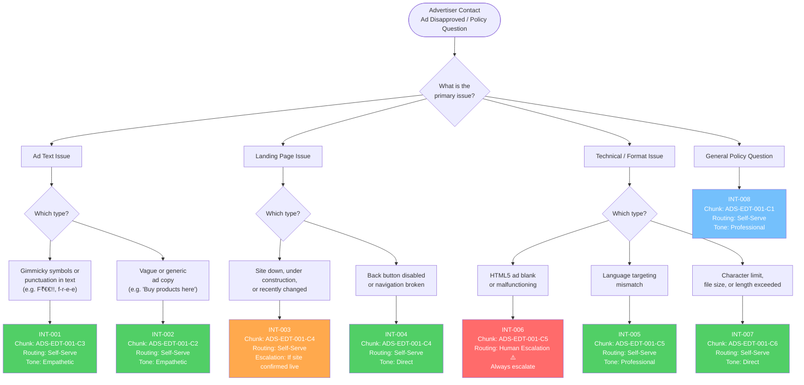
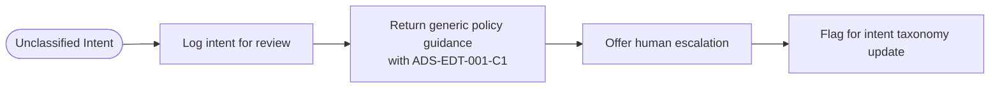

# Intent Tree — Google Ads AI Support Assistant
## Policy Scope: Editorial and Technical Requirements (ADS-EDT-001)

This diagram maps advertiser support queries to their classified intent, knowledge chunk, and routing outcome.

## Routing Legend

| Color | Routing | Meaning |
|---|---|---|
| Green | Self-Serve | AI assistant resolves without human involvement |
| Orange | Self-Serve with Escalation Condition | AI resolves, but escalates if a specific condition is met |
| Red | Human Escalation | Always handed off to a human support agent |
| Blue | General | Informational response, no action required |

## Unknown Intent — Graceful Degradation

If no intent is matched with confidence ≥ 0.70, the system routes to this fallback path:

