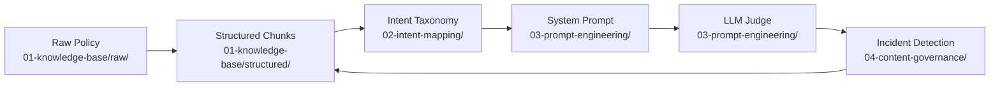

# Google Ads AI Knowledge Strategist

A portfolio project demonstrating the core work of an AI and Knowledge Strategist — structuring knowledge for AI retrieval, mapping advertiser intent, engineering prompt constraints, and governing content quality through automated evaluation.

Built on a real Google Ads policy and six realistic advertiser support scenarios.

**Live evaluation tool:** [ads-evaluator.web.app](https://ads-evaluator.web.app)

---

## The Scenario

An advertiser opens the Google Ads AI support assistant and types:

> *"My ad was disapproved. I don't understand why."*

Behind that single sentence, everything in this project has to be in place for the AI to give a correct, safe, and helpful answer — and what happens when something breaks.

---

## Project Structure

```
google-ads-ai-knowledge-strategist/
├── 01-knowledge-base/       # RAG-ready knowledge chunks and metadata schema
├── 02-intent-mapping/       # Intent taxonomy, classification tree, training examples
├── 03-prompt-engineering/   # System prompt, hyperparameters, LLM judge rubric
├── 04-content-governance/   # Launch checklist, incident template, incident report
└── 05-evaluator-tool/       # Live evaluation tool — React + Flask + Gemini
```

---

## Six Advertiser Situations

Every artifact in this project traces back to one of these six real support scenarios:

| # | Advertiser Situation | Policy Rule Triggered | Routing |
|---|---|---|---|
| 1 | Ad uses `F₹€€!!` in headline | Gimmicky symbols prohibited | Self-serve |
| 2 | Headline says "Buy great products here" | Vague copy prohibited | Self-serve |
| 3 | Ad approved last week, disapproved today | Destination must remain functional | Self-serve → escalate if site confirmed live |
| 4 | Competitor's ads run fine, mine don't | Back button disabled on landing page | Self-serve |
| 5 | Targeting Spanish speakers with English ads | Ad language must match targeting language | Self-serve |
| 6 | HTML5 banner appears blank on mobile | HTML5 ads must function in all environments | Human escalation (always) |

---

## How the Four Areas Connect



A policy change flows through every layer: the knowledge base chunk is updated first, which triggers intent taxonomy review, which may require a system prompt patch, which is verified by the LLM judge, which monitors for residual quality issues in production.

---

## Area 1 — Knowledge Base

**What I did:** Took the raw Google Ads Editorial and Technical Requirements policy and converted it into 6 RAG-ready JSON chunks. Each chunk covers exactly one rule and is tagged with 17 metadata fields — policy ID, trigger condition, intent match, routing, token count, staleness date, and more.

**Why it matters:** A RAG system retrieves by metadata first, then by semantic similarity. Without precise tagging, the wrong chunk gets retrieved and the AI gives wrong advice. The token count field enforces budget discipline per API call.

**Key files:**
- [`01-knowledge-base/raw/editorial-technical-requirements.md`](01-knowledge-base/raw/editorial-technical-requirements.md) — original policy text, unedited
- [`01-knowledge-base/structured/editorial-technical-requirements.json`](01-knowledge-base/structured/editorial-technical-requirements.json) — 6 tagged chunks
- [`01-knowledge-base/metadata-schema.json`](01-knowledge-base/metadata-schema.json) — JSON Schema defining all 17 fields

---

## Area 2 — Intent Mapping

**What I did:** Analyzed the six advertiser situations and built an intent classification system — a taxonomy of 8 intents, a Mermaid routing tree, and 6 few-shot training examples showing how the AI should respond to each intent.

**Why it matters:** Intent routing determines which knowledge chunk gets retrieved, what tone the AI uses, and whether the query goes to self-serve or human escalation. A misrouted query means the right chunk never gets retrieved, regardless of how well it's tagged.

**Key files:**
- [`02-intent-mapping/intent-taxonomy.json`](02-intent-mapping/intent-taxonomy.json) — 8 intents with confidence thresholds and routing outcomes
- [`02-intent-mapping/intent-tree.md`](02-intent-mapping/intent-tree.md) — visual classification flowchart
- [`02-intent-mapping/few-shot-dataset.jsonl`](02-intent-mapping/few-shot-dataset.jsonl) — 6 input/output training pairs

---

## Area 3 — Prompt Engineering

**What I did:** Wrote a full system prompt with positive constraints, prohibited behaviors, output format requirements, escalation triggers, and graceful degradation logic. Then simulated a production hallucination incident and patched the prompt in v2.

**Why it matters:** The system prompt is the instruction layer — it governs everything the AI is and isn't allowed to do. Version 2 shows what happens when a constraint is missing: the AI cited a stale destination policy rule and gave wrong advice to ~34 advertisers. The patch added a chunk freshness gate.

**Key files:**
- [`03-prompt-engineering/system-prompt-v1.md`](03-prompt-engineering/system-prompt-v1.md) — original prompt
- [`03-prompt-engineering/system-prompt-v2.md`](03-prompt-engineering/system-prompt-v2.md) — patched version with annotated change log
- [`03-prompt-engineering/hyperparameter-guide.md`](03-prompt-engineering/hyperparameter-guide.md) — Temperature/Top-P settings per intent
- [`03-prompt-engineering/llm-judge-rubric.json`](03-prompt-engineering/llm-judge-rubric.json) — 5-dimension automated evaluation rubric

---

## Area 4 — Content Governance

**What I did:** Built the process layer — a product launch readiness checklist, a reusable incident report template, and a fully worked incident report for the stale destination policy hallucination.

**Why it matters:** AI quality degrades silently as policies change. The incident report shows the full lifecycle: LLM judge detects a score drop → root cause traced to a stale chunk → patch applied → verified against rubric → prevention rule added to system prompt v2.

**Key files:**
- [`04-content-governance/launch-readiness-checklist.md`](04-content-governance/launch-readiness-checklist.md) — 6-stage gated checklist
- [`04-content-governance/incident-report-example.md`](04-content-governance/incident-report-example.md) — full worked incident (INC-2026-EDT-001)
- [`04-content-governance/incident-report-template.md`](04-content-governance/incident-report-template.md) — reusable blank template

---

## Area 5 — Live Evaluation Tool

**What I did:** Built a working LLM-as-a-judge evaluation tool that scores Google Ads AI support responses in real time against the 5-dimension rubric. Deployed on Google Cloud Run (backend) and Firebase Hosting (frontend), powered by Gemini.

**Try it:** [ads-evaluator.web.app](https://ads-evaluator.web.app)

Paste a support conversation, select the intent, click Evaluate. The tool returns a score (0–100), a production readiness verdict, and per-dimension feedback.

**Stack:** React + TypeScript + Vite · Python Flask · Google Cloud Run · Firebase Hosting · Gemini API

**Key files:**
- [`05-evaluator-tool/app.py`](05-evaluator-tool/app.py) — Flask backend
- [`05-evaluator-tool/src/components/EvaluatorPanel.tsx`](05-evaluator-tool/src/components/EvaluatorPanel.tsx) — main UI
- [`05-evaluator-tool/src/lib/evaluationRubric.ts`](05-evaluator-tool/src/lib/evaluationRubric.ts) — scoring logic

---

## Source Policy

All content is based on the official Google Ads policy:
**Editorial and Technical Requirements** — [support.google.com/adspolicy/answer/6008942](https://support.google.com/adspolicy/answer/6008942)
