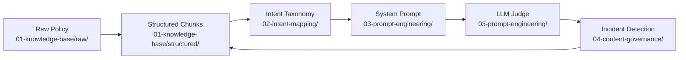

# Google Ads AI Knowledge Strategist — Portfolio Project

This project simulates the core work of an AI and Knowledge Strategist supporting Google Ads customer-facing AI solutions. It is built around a real Google Ads policy — Editorial and Technical Requirements — and six realistic advertiser support scenarios derived from that policy.

The project covers four areas of practice: knowledge structuring, intent mapping, prompt engineering, and content governance.

---

## Scenario

An advertiser opens the Google Ads AI support assistant and types: *"My ad was disapproved. I don't understand why."*

Behind that single sentence, this project shows everything that has to be in place for the AI to give a correct, safe, and helpful answer — and what happens when something breaks.

---

## Project Structure

```
google-ads-ai-knowledge-strategist/
├── 01-knowledge-base/       # Structured knowledge chunks and metadata schema
├── 02-intent-mapping/       # Intent taxonomy, routing tree, and training examples
├── 03-prompt-engineering/   # System prompt, hyperparameters, and evaluation rubric
└── 04-content-governance/   # Launch checklist, incident template, and incident report
```

---

## The Six Advertiser Situations

All artifacts in this project are grounded in these six scenarios:

| # | Situation | Policy Rule | Routing |
|---|---|---|---|
| 1 | Ad text uses `F₹€€!!` | Gimmicky symbols prohibited | Self-serve |
| 2 | Headline says "Buy great products here" | Vague copy prohibited | Self-serve |
| 3 | Ad approved last week, disapproved today | Destination must remain functional | Self-serve → escalate if site confirmed live |
| 4 | Competitor's ads run fine, mine don't | Back button disabled on landing page | Self-serve |
| 5 | Targeting Spanish speakers with English ads | Ad language must match targeting | Self-serve |
| 6 | HTML5 banner blank on mobile | HTML5 ads must function in all environments | Human escalation (always) |

---

## How the Four Areas Connect



A policy change flows through every layer: the knowledge base chunk is updated first, which triggers intent taxonomy review, which may require a system prompt patch, which gets verified by the LLM judge, which monitors for any residual quality issues.

---

## Source Policy

All content is based on the official Google Ads policy:
**Editorial and Technical Requirements** — https://support.google.com/adspolicy/answer/6008942

---

## Skills Demonstrated

- RAG knowledge base design — chunking, tagging, token optimization
- Metadata schema authoring (JSON Schema)
- Intent classification and routing logic
- Few-shot training dataset construction
- System prompt engineering — constraints, escalation triggers, graceful degradation
- Hyperparameter tuning rationale
- LLM-as-a-judge evaluation framework design
- Root cause analysis and incident documentation
- Content governance process design
